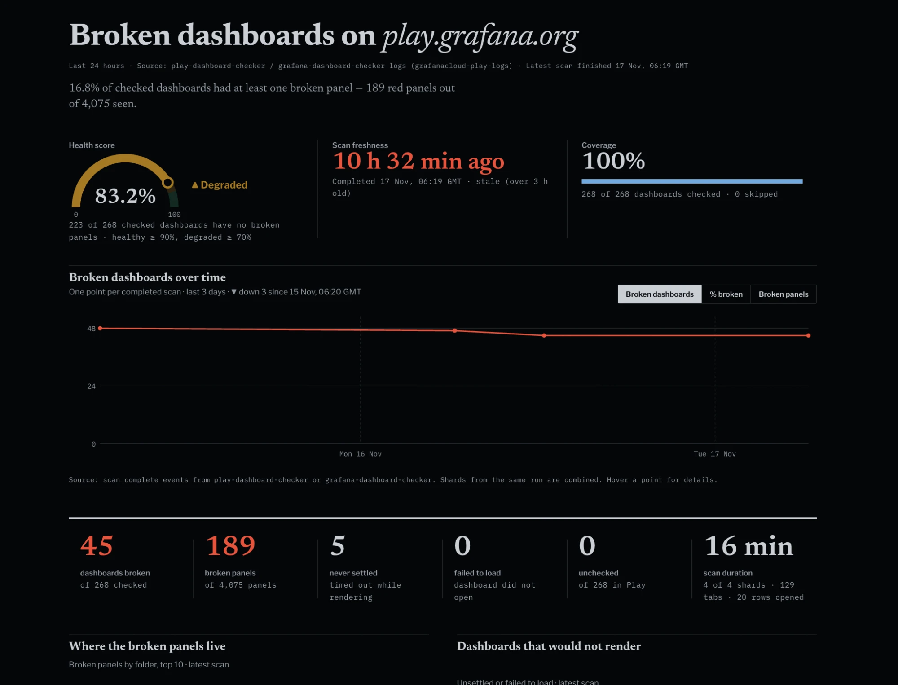
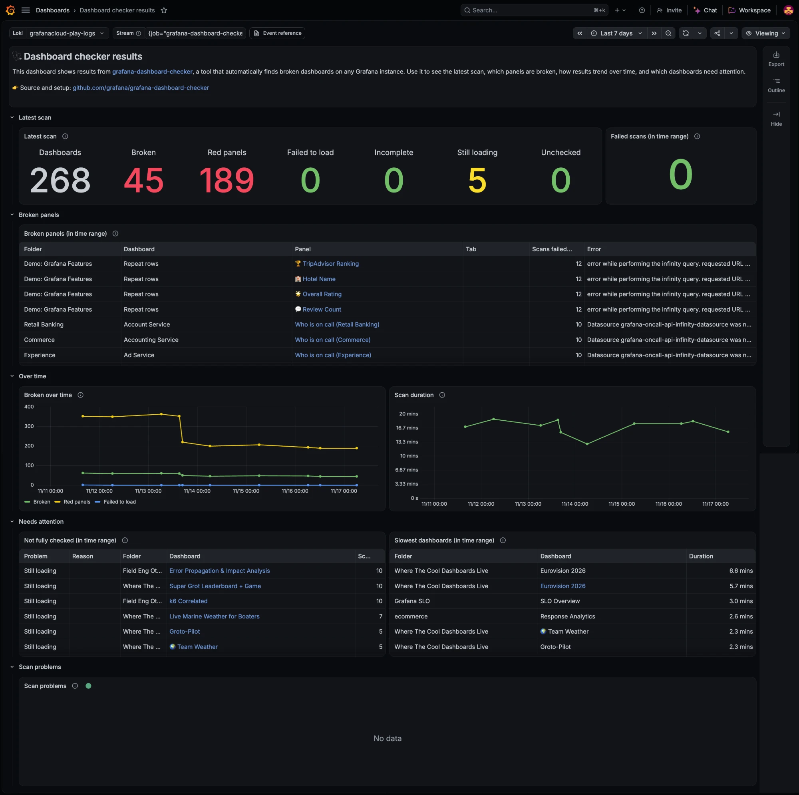

# Grafana Dashboard Checker

Finds broken dashboards on a Grafana stack. It opens every dashboard in a headless browser, the way a
person would, and reports each panel showing Grafana's red error icon. "No data" panels don't count.



**See it working:** the checker scans Grafana's own public Play instance. The
[Broken dashboards on play.grafana.org](https://play.grafana.org/a/grafana-assistant-app/pages/play-broken-dashboards-053b73b31d4b)
report is a live example of what its results look like.

## How it works

1. Lists dashboards from `/api/search`, optionally filtered by folder, tag or uid.
2. For each dashboard, k6's browser module (`dashboard_checker/browser/scan.js`) loads the page in headless Chromium,
   waits for the panels to finish loading, expands collapsed rows, and clicks through every tab.
3. Any panel with the red error icon marks the dashboard as broken.
4. Results are printed as JSON log lines, and can be pushed to Loki or served as Prometheus metrics.

## Scan your own stack

Needs **Grafana 11.3 or later** (self-hosted or Grafana Cloud). Older versions are refused, since the
checker would miss panel errors there; see
[Supported Grafana versions](docs/reference.md#supported-grafana-versions).

> [!WARNING]
> The scan runs **every query on every dashboard it opens**, just as if someone viewed it. Against
> data sources that bill per query (BigQuery, Athena, CloudWatch, ...) that costs money, and it adds
> load to your data sources. Start small with `CHECKER_LIMIT_DASHBOARDS` or the folder/tag filters,
> and exclude anything expensive.

1. Create a [service account](https://grafana.com/docs/grafana/latest/administration/service-accounts/)
   with the **Viewer** role and add a token. The checker only reads. Skip this if your dashboards are
   public to anonymous visitors.
2. Run one scan with the released image:

   ```sh
   export CHECKER_GRAFANA_TOKEN=glsa_...   # the token from step 1
   docker run --rm \
     -e CHECKER_MODE=once \
     -e CHECKER_BASE_URL=https://your-stack.grafana.net \
     -e CHECKER_GRAFANA_TOKEN \
     -e CHECKER_LIMIT_DASHBOARDS=10 \
     ghcr.io/grafana/grafana-dashboard-checker:latest
   ```

3. Look for `panel_failed` lines in the output. Each one names the dashboard and panel, with a link.
   Add `-e CHECKER_INCLUDE_ERROR_TEXT=true` to also record each panel's error message. It's off by
   default because error messages can contain hostnames, query text or other internal details.

To keep the results, set `LOKI_URL`, `LOKI_USERNAME` and `LOKI_TOKEN` to push them to Loki, or run
without `CHECKER_MODE=once` to serve `/metrics` and scan on a timer.

### Results dashboard



[dashboards/results.json](dashboards/results.json) is a ready-made Grafana dashboard for the results in
Loki: the latest scan, every broken panel with a link to it, trends over time, dashboards that weren't
fully checked, and failed scans. Import it (**Dashboards → New → Import**, Grafana 11.3 or later), then
pick your Loki data source and set **Stream** to the stream the checker pushes to. That's
`{job="dashboard-checker"}` by default, or `{job="<your LOKI_JOB_LABEL>"}` if you set one. In
continuous mode, use whatever labels your log shipper adds. Save the dashboard to keep your choice.

Every setting, the log line format, the filters and the known limits are in
[docs/reference.md](docs/reference.md).

## Contributing

See [CONTRIBUTING.md](CONTRIBUTING.md). Everyone taking part follows Grafana Labs'
[code of conduct](https://github.com/grafana/.github/blob/main/CODE_OF_CONDUCT.md). To report a security
issue, follow Grafana Labs' [security policy](https://github.com/grafana/.github/blob/main/SECURITY.md).

## License

[Apache License 2.0](LICENSE). The Docker image is built on `grafana/k6:latest-with-browser`, so it
also contains k6 and Chromium, each under its own license.
